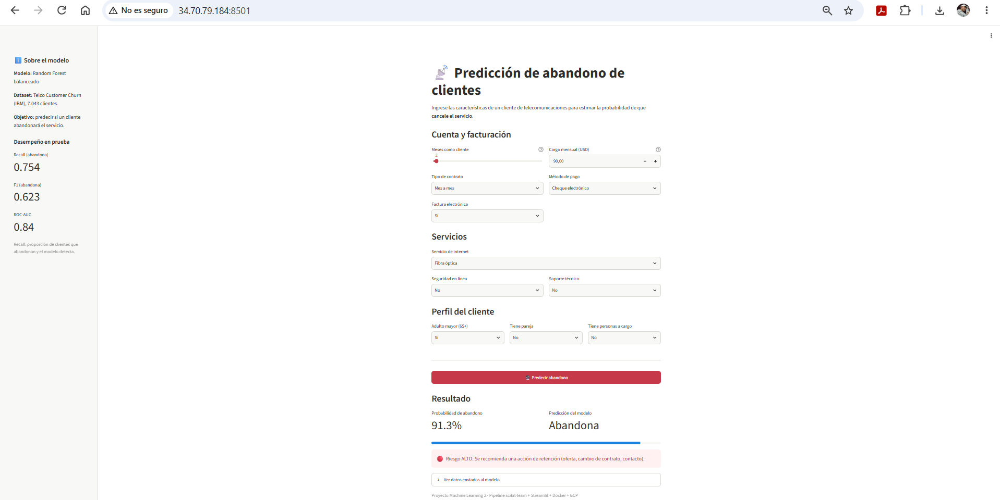

# 📡 Predicción de abandono de clientes (Telco Customer Churn)

Solución completa de Machine Learning: desde el dataset hasta el despliegue en
Google Cloud. Incluye entrenamiento reproducible (`train.py`), una app web en
Streamlit (`app.py`), empaquetado con Docker y despliegue en una VM de
Google Compute Engine.

## 🚀 App desplegada
- **URL:** http://34.70.79.184:8501
- **Infraestructura:** VM de Google Compute Engine (Debian 13, us-central1) + contenedor Docker.
- **Notebook de desarrollo:** `Taller_ML2_Churn.ipynb` (exploración, limpieza, comparación de modelos y pruebas).

*Caso 1 evaluado en la app desplegada: probabilidad de abandono de 91,3 % → Riesgo ALTO.*

## 1. Objetivo
Predecir si un cliente de una empresa de telecomunicaciones **abandonará el
servicio (churn)**, para poder aplicar acciones de retención a tiempo.

## 2. Dataset
- **Fuente:** Telco Customer Churn (IBM), dataset público.
  URL original: https://raw.githubusercontent.com/IBM/telco-customer-churn-on-icp4d/master/data/Telco-Customer-Churn.csv
- **Ubicación en el repo:** `data/telco_churn.csv`
- **Tamaño:** 7.043 filas × 21 columnas.
- **Unidad de observación:** cada fila es **un cliente**.
- **Variable objetivo:** `Churn` (Yes = abandona, No = se queda).
- **Desbalance:** 73,5 % se queda / 26,5 % abandona.

## 3. Ruta elegida
**Ruta A – Aprendizaje supervisado:** clasificación binaria.

## 4. Variables utilizadas (11)
| Tipo | Variable | Descripción |
|---|---|---|
| Numérica | `tenure` | Meses como cliente |
| Numérica | `MonthlyCharges` | Cargo mensual (USD) |
| Categórica | `Contract` | Tipo de contrato |
| Categórica | `InternetService` | Tipo de servicio de internet |
| Categórica | `PaymentMethod` | Método de pago |
| Categórica | `OnlineSecurity` | Tiene seguridad en línea |
| Categórica | `TechSupport` | Tiene soporte técnico |
| Categórica | `PaperlessBilling` | Factura electrónica |
| Categórica | `SeniorCitizen` | Adulto mayor (65+) |
| Categórica | `Partner` | Tiene pareja |
| Categórica | `Dependents` | Tiene personas a cargo |

**Variables excluidas:**
- `customerID`: identificador, sin valor predictivo.
- `TotalCharges`: correlación ≈ 0,99 con `tenure × MonthlyCharges` (redundante)
  y permitiría entradas inconsistentes en la app.
- `gender`, `PhoneService`: la tasa de abandono casi no cambia entre sus categorías.

**Hallazgo clave de la exploración:** el abandono es de 42,7 % en contratos
mes a mes, 11,3 % en contratos de un año y 2,8 % en contratos de dos años.

## 5. Preparación de datos
- `TotalCharges` venía como texto: 11 clientes con `tenure = 0` (clientes nuevos
  sin cobro aún) lo tenían vacío. Se convirtió a numérico.
- `SeniorCitizen` (0/1) se pasó a `No`/`Yes`, consistente con las demás categóricas.
- `Churn` se codificó como 1 (abandona) / 0 (se queda).
- División 80/20 estratificada (`random_state=42`).
- Todo el preprocesamiento está **dentro del Pipeline** de scikit-learn:
  - Numéricas: imputación por mediana + `StandardScaler`.
  - Categóricas: imputación por moda + `OneHotEncoder(handle_unknown="ignore")`.

Así, la app aplica exactamente las mismas transformaciones que el entrenamiento.

## 6. Modelo y justificación
Se compararon tres modelos dentro del mismo Pipeline:

| Modelo | Comentario |
|---|---|
| Regresión logística | Línea base |
| Regresión logística balanceada | `class_weight="balanced"` |
| **Random Forest balanceado** ✅ | Mejor F1 en la clase "abandona" |

Modelo final: `RandomForestClassifier(n_estimators=300, max_depth=10,
min_samples_leaf=10, class_weight="balanced", random_state=42)`.
`class_weight="balanced"` compensa el desbalance; `max_depth` y
`min_samples_leaf` limitan el sobreajuste y el tamaño del archivo.

## 7. Evaluación (conjunto de prueba, 1.409 clientes)
| Métrica (clase "abandona") | Valor |
|---|---|
| Recall | 0,75 |
| Precisión | 0,53 |
| F1 | 0,62 |
| ROC-AUC | 0,84 |
| Accuracy | 0,76 |
| F1 weighted | 0,77 |

**Matriz de confusión:**

| | Predicho: se queda | Predicho: abandona |
|---|---|---|
| **Real: se queda** | 785 | 250 |
| **Real: abandona** | 92 | 282 |

**¿Por qué F1 y recall y no solo accuracy?** Con 26,5 % de abandono, un modelo
que siempre dijera "se queda" tendría 73,5 % de accuracy sin detectar a nadie.
Para el negocio es más costoso no detectar a un cliente que se va (falso
negativo) que una falsa alarma (falso positivo), por eso se prioriza recall y
se elige el modelo con mejor F1. El modelo detecta 282 de 374 abandonos (75 %).

## 8. Interpretación de la salida de la app
La app muestra:
- **Probabilidad de abandono** (0–100 %).
- **Predicción:** "Abandona" si la probabilidad ≥ 50 %, si no "Se queda".
- **Nivel de riesgo:** 🟢 bajo (< 30 %), 🟡 medio (30–60 %), 🔴 alto (≥ 60 %),
  con una recomendación de acción.

Si el cliente **no tiene internet**, los campos "Seguridad en línea" y
"Soporte técnico" se fijan automáticamente en "Sin servicio de internet"
para evitar combinaciones imposibles.

## 9. Estructura del proyecto
~~~
telco-churn-streamlit/
├── app.py              # App Streamlit (carga el modelo, NO reentrena)
├── train.py            # Entrenamiento reproducible → model.joblib
├── model.joblib        # Pipeline entrenado + metadatos para la interfaz
├── requirements.txt    # Dependencias con versiones fijas
├── Dockerfile          # Construcción de la imagen
├── .dockerignore       # Archivos excluidos de la imagen
├── README.md
└── data/
    └── telco_churn.csv # Dataset
~~~

## 10. Cómo ejecutar `train.py` (reentrenar el modelo)
Requiere Python 3.13.
~~~bash
pip install -r requirements.txt
python train.py
~~~
Salida esperada: matriz de confusión, reporte de clasificación, métricas y
`Modelo guardado en .../model.joblib`.

## 11. Cómo ejecutar Streamlit (sin Docker)
~~~bash
pip install -r requirements.txt
streamlit run app.py
~~~
Abrir http://localhost:8501

## 12. Cómo construir la imagen Docker
Desde la carpeta del proyecto:
~~~bash
docker build -t ml-streamlit-app .
docker images
~~~

## 13. Cómo ejecutar el contenedor
Prueba interactiva (se detiene con Ctrl+C):
~~~bash
docker run --rm -p 8501:8501 ml-streamlit-app
~~~
En segundo plano (modo despliegue):
~~~bash
docker run -d --name ml-streamlit --restart unless-stopped -p 8501:8501 ml-streamlit-app
docker ps
docker logs ml-streamlit
~~~
Abrir `http://localhost:8501` (local) o `http://IP_EXTERNA:8501` (VM).

## 14. Despliegue en Google Cloud (Compute Engine)
1. Crear una VM Linux (**Ubuntu 24.04 LTS** o **Debian**; en este proyecto se usó Debian 13) con IP externa
   y la etiqueta de red `streamlit-server`.
2. Abrir la terminal con el botón **SSH** de la consola e instalar Docker y Git:
~~~bash
sudo apt update
sudo apt install -y docker.io git
sudo systemctl enable --now docker
~~~
3. Clonar y desplegar:
~~~bash
git clone https://github.com/hudynikolasbarrera-ship-it/telco-churn-streamlit.git
cd telco-churn-streamlit
sudo docker build -t ml-streamlit-app .
sudo docker run -d --name ml-streamlit --restart unless-stopped -p 8501:8501 ml-streamlit-app
~~~
4. Crear la regla de firewall (desde Cloud Shell):
~~~bash
gcloud compute firewall-rules create allow-streamlit-8501 --allow=tcp:8501 --direction=INGRESS --target-tags=streamlit-server
~~~
5. Abrir `http://IP_EXTERNA_DE_LA_VM:8501`

**Actualizar la app después de cambios en GitHub:**
~~~bash
git pull
sudo docker stop ml-streamlit && sudo docker rm ml-streamlit
sudo docker build -t ml-streamlit-app .
sudo docker run -d --name ml-streamlit --restart unless-stopped -p 8501:8501 ml-streamlit-app
~~~

⚠️ Al terminar, **detener o eliminar la VM** para no consumir créditos.

## 15. Ejemplos de entrada y salida
| Variable | Caso 1 | Caso 2 | Caso 3 |
|---|---|---|---|
| Meses como cliente | 2 | 60 | 20 |
| Cargo mensual | 90 | 25 | 70 |
| Contrato | Mes a mes | Dos años | Un año |
| Internet | Fibra óptica | No | DSL |
| Método de pago | Cheque electrónico | Transferencia (automática) | Tarjeta de crédito (automática) |
| Seguridad en línea | No | Sin servicio de internet | Sí |
| Soporte técnico | No | Sin servicio de internet | No |
| Factura electrónica | Sí | No | Sí |
| Adulto mayor | Sí | No | No |
| Tiene pareja | No | Sí | Sí |
| Personas a cargo | No | Sí | No |
| **Probabilidad de abandono** | **91,3 %** | **0,9 %** | **19,4 %** |
| **Predicción** | 🔴 Abandona | 🟢 Se queda | 🟢 Se queda |

## 16. Solución de problemas
| Situación | Revisión |
|---|---|
| `docker build` falla | Leer el error completo; revisar `requirements.txt` y `Dockerfile`. |
| El contenedor se detiene | `sudo docker ps -a` y `sudo docker logs ml-streamlit`. |
| Funciona en la VM pero no desde fuera | Revisar regla de firewall, etiqueta `streamlit-server` e IP externa. |
| Cambios no aparecen | `git pull` → detener/eliminar contenedor → `docker build` → `docker run`. |

## 16.1 Pruebas realizadas
- `train.py` reproduce exactamente las métricas del notebook (misma matriz de confusión: 785 / 250 / 92 / 282).
- Prueba automática con `streamlit.testing.v1.AppTest`: la app carga sin errores, el botón "Predecir" devuelve 91,3 % para el Caso 1 y la validación "sin internet" bloquea los campos dependientes.
- Imagen Docker construida en la VM y contenedor en estado `healthy`.
- Flujo de actualización probado: cambio en GitHub → `git pull` → `docker build` → nuevo contenedor.

## 16.2 Prueba cruzada
| Campo | Detalle |
|---|---|
| Realizada por | *(nombre del compañero)* |
| Fecha | *(fecha)* |
| ¿Clonó y construyó solo con el README? | *(Sí / No)* |
| ¿El contenedor funcionó? | *(Sí / No)* |
| Observaciones | *(instrucciones faltantes o errores encontrados)* |

## 17. Autor
- Nicolás Barrera Castañeda

Machine Learning 2
